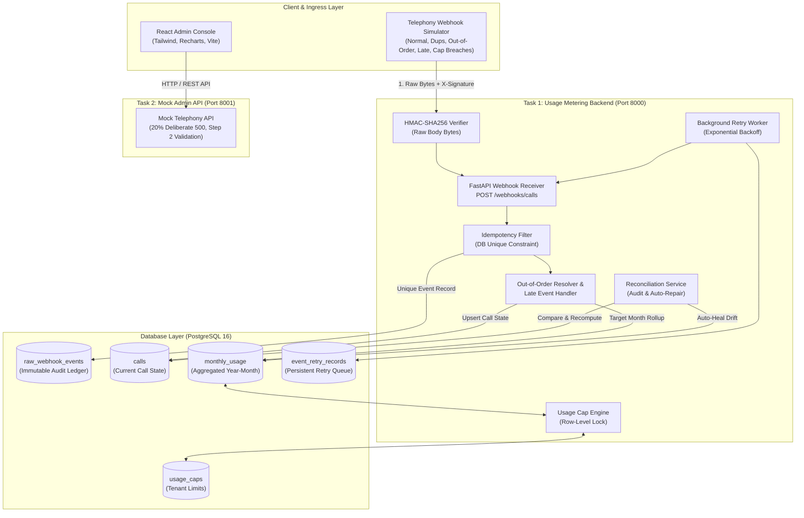

# System Architecture Specification

## Callzo Telephony Metering & Administration Platform

---

## 1. Task 1: Backend Usage Metering Architecture

### 1.1 Ingestion Pipeline
1. **Raw Byte Ingress**: The incoming HTTP request payload stream is read directly as unparsed bytes (`await request.body()`).
2. **HMAC-SHA256 Verification**:
   - The secret key is loaded from the environment (`WEBHOOK_SECRET`).
   - The hash is generated over the exact raw byte sequence.
   - Constant-time comparison via `hmac.compare_digest` prevents timing attacks.
   - Any missing or non-matching signature immediately returns HTTP 401 without executing further application logic.
3. **Strict Validation**: The payload is deserialized and strictly validated against Pydantic v2 models (`WebhookCallEvent`). Unknown event types, negative durations, or missing fields fail with HTTP 400 or 422.
4. **Idempotency**:
   - The `event_id` is written to `raw_webhook_events` under a unique constraint.
   - Duplicate deliveries (detected either via pre-query or unique constraint violation on concurrent requests) return HTTP 200 with status `"duplicate"`, safely exiting without double-metering.

### 1.2 State Resolution & Out-of-Order Handling
- Calls are keyed by `call_id`.
- If `call.ended` arrives before `call.started`:
  - Call is stored as `status = "ended"` with duration and cost.
  - The monthly usage aggregate is incremented.
  - When `call.started` subsequently arrives, the system notes the start time but **never overwrites** the ended status or re-increments metrics.
- If `call.started` arrives first:
  - Call is created as `status = "started"`.
  - When `call.ended` arrives, the duration, cost, and end time are recorded, and metrics roll up to the monthly aggregate.

### 1.3 Late-Event Accounting
- Events with timestamps ~35 days in the past are partitioned into their historical billing month (`event.timestamp.strftime("%Y-%m")`).
- This guarantees current month metrics remain clean and unaffected by delayed telephony network syncs.

### 1.4 Monthly Usage Caps
- Accounts can configure minutes and cost limits.
- Evaluated atomically within a database transaction using PostgreSQL row-level locks (`SELECT ... FOR UPDATE`).
- Once breached, responses flag `hard_limit_exceeded` or `soft_limit_exceeded`.

---

## 2. Task 2: Usage Admin Console Architecture

### 2.1 State Hierarchy
- **Server State**: Managed via dedicated custom hooks (`useAccounts`, `useSummary`) with race-condition prevention using active request ID tracking.
- **Client Form State**: Kept in local component memory for 60fps input responsiveness while debouncing autosave requests.
- **Selection State**: A persistent `Set<string>` of account IDs that remains stable across pagination, sorting, search, and 30-second silent periodic refreshes.

### 2.2 Resilient API Layer
- Summary endpoint incorporates bounded exponential backoff (`fetchWithRetry`) to transparently absorb the mock API's deliberate 20% HTTP 500 error rate.
- If retries exhaust, an inline error card with manual retry is rendered, ensuring the account directory and other features remain 100% accessible.
- Deliberate Step 2 validation behavior (`billing_country is required` after step 4) is captured and presented cleanly with single-click confirmation, preventing wizard resets.
